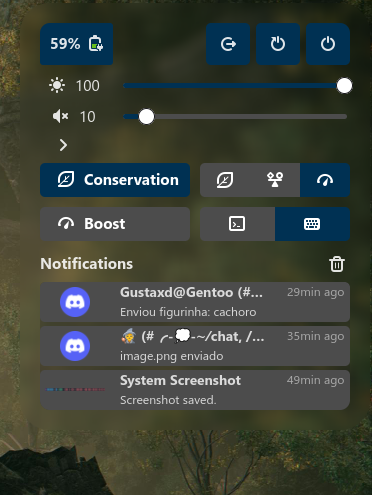

# Vinii's Graphical System Controller

A system quick settings menu

## Showcase



## Requirements 

This project was built on top of libsystemd so it absolutely requires: 

<ul>
    <li>Systemd</li>
    <li>D-Bus</li>
</ul>

## Additional Requirements

> [!NOTE]
> This project is very modular but no additional modules have yet been implemented.  
> It currently is tailored for my specific system and thus the following requirements exist.

<ul>
    <li>PipeWire</li>
    <li>X Keyboard Extension (and by extension X11)</li>
    <li>Dunst</li>
    <li>A Lenovo notebook(laptop)</li>
</ul>

## Extra

To properly use it I set up some extra external settings.

### Picom

<ul>
    <li>
        Set this opacity rule: <code>100:class_g = 'vgsc'</code>
    </li>
    <li>
        Set this corner radius rule: <code>30:class_g = 'vgsc' && window_type = 'normal'</code>
    </li>
</ul>

### i3wm

<ul>
    <li>
        Set this: <pre><code>
for_window [class="vgsc"]\
    floating enable,\
    border pixel 0,\
    move position 1568 40 
</code></pre>
    </li>
</ul>

### Polybar

<ul>
    <li>
        For custom modules I can just add <code>click-left = vgsc</code> (vgsc being in my $PATH)
    </li>
    <li>
        For builtin polybar modules I had to wrap its label in an action, for example: <code>label-charging = %{A1:vgsc:}%percentage%%%{A}</code>
    </li>
</ul>

## WIP

### Bugs
- Battery charging under 10% does not display icon

### TODOs
- Handle individual_audio input: mute, and volume
- Add individual_audio tooltips
- Function ```exec_command_as_user``` does not propagate errors with messages
- Restructure frontend to avoid excessive ```g_warning!()``` macro calls, prefer Result type (unless inside closure)
- Simplify audio.rs, audio_individual.rs, brightness.rs
- Create a cache

- Check for unecessary backend requests, avoid allowing performance request if performance is active?

- Use ConversionError instead of u32 error

Icons reference:
- https://gitlab.gnome.org/GNOME/adwaita-icon-theme/-/blob/master/Adwaita/symbolic/status

<!-- # Dev -->

<!-- debug -->
<!-- cmake --preset debug -->
<!-- cmake --build --preset debug -->
<!-- cargo run -->
